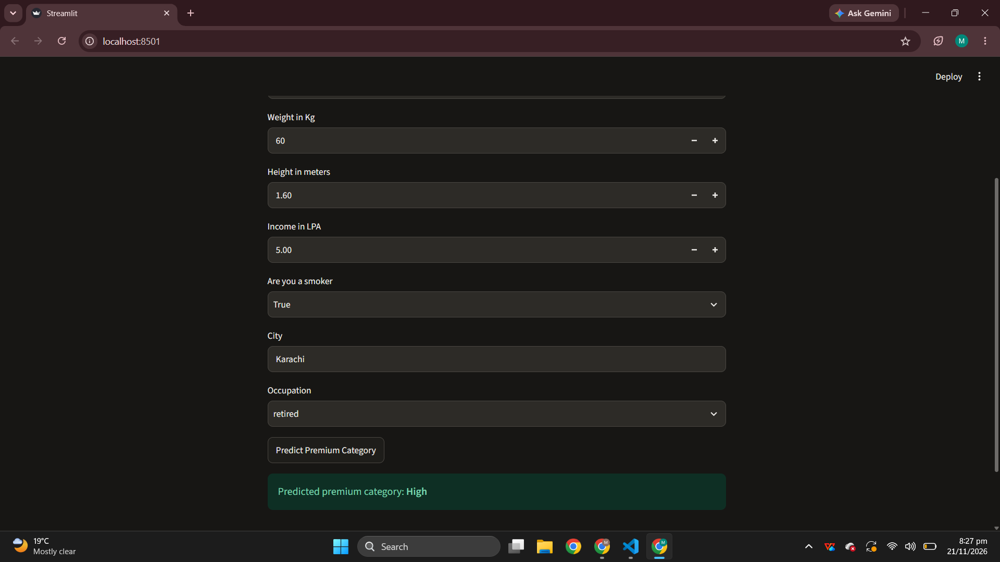

# Insurance Premium Category Prediction

A simple machine learning project that predicts insurance premium categories based on user details such as age, BMI, income, smoking habits, city, and occupation.

Built this project to practice serving a trained ML model using **FastAPI** and creating an interactive frontend with **Streamlit**.

## Tech Stack

- Python
- FastAPI
- Streamlit
- Scikit-learn
- Pandas
- Pydantic

## Features

- Predicts insurance premium categories (Low, Medium, High)
- Validates user inputs using Pydantic
- Calculates BMI and other features automatically
- Uses a trained ML model for predictions
- Provides a simple Streamlit interface

## How to Run

**1. Install dependencies**

```bash
pip install -r requirements.txt
```

**2. Start the FastAPI backend**

```bash
python -m fastapi dev main.py
```

**3. Start the Streamlit frontend in another terminal**

```bash
python -m streamlit run frontend.py
```

Open http://localhost:8501 to use the application.

## Preview



